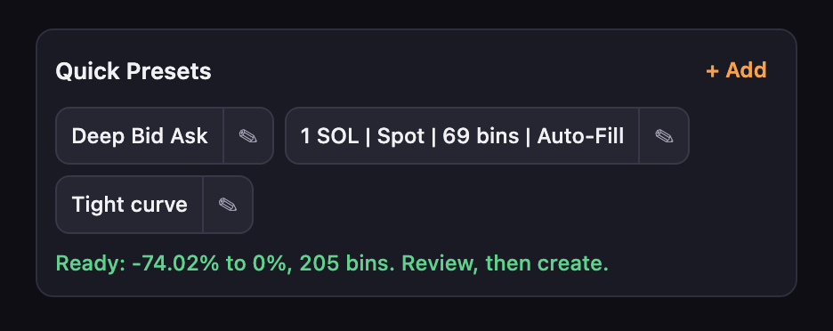
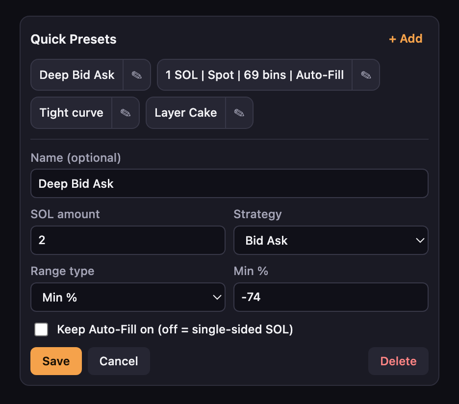

<div align="center">


# Meteora Quick Presets

**One-click presets for Meteora's DLMM Create Position panel.** Pick a preset and the SOL amount, strategy and price range are filled in for you. You still review and confirm every position yourself.

[](https://github.com/mzogot/MeteoraQuickPresets/releases/latest)


[](LICENSE)

[**⬇ Download**](https://github.com/mzogot/MeteoraQuickPresets/releases/latest) · [Install](#install) · [How to use it](#how-to-use-it) · [Privacy](#privacy-and-permissions) · [Security](#security) · [Changelog](CHANGELOG.md)

<br>



</div>

> [!IMPORTANT]
> This is an unofficial community tool. It is not affiliated with or endorsed by Meteora. Only install it from [this repository](https://github.com/mzogot/MeteoraQuickPresets). See [Security](#security) for how to check a download.

## Why

Opening a DLMM position means setting the same few fields every time: amount, Auto-Fill, strategy, Min price. If you use the same setups across many pools, that is a lot of repeated typing, and each pool's bin step changes how many bins a given percentage covers.

- **One click per setup.** Save the positions you open most and apply them from a bar above the panel.
- **Range by percent or by bins.** Set a Min %, or ask for a total bin count and the extension works out the Min price from the pool's bin step.
- **It never submits.** The extension only fills in the form. Creating the position is still your click, and your wallet still asks you to sign.
- **No wallet access and no network access.** It has no code that talks to a wallet or a server.
- **Free and open source** under the MIT license.

## Features



Each preset stores:

| Setting | Options |
| --- | --- |
| **Name** | Optional, up to 40 characters. Without one, the button shows the preset's settings. |
| **Side** | SOL, or Token for a single-sided token position. |
| **Amount** | SOL side: any amount above 0. Token side: a percentage of your token balance, from the 25%, 50% and 100% shortcuts or any value you type. |
| **Strategy** | Spot, Curve or Bid Ask. |
| **Range** | SOL side: Min % (between -99.99 and 0) or total bins (2 or more). Token side: Max % (above 0) or total bins, starting at the current price. |
| **Auto-Fill** | SOL side only. Off for a single-sided SOL position, on to let Meteora balance both tokens. Always off on the Token side. |

The bar shows each step as it runs and tells you what stopped it if something goes wrong. If you click or type in the panel, or the page changes, a running preset stops straight away. Presets stay in sync across open Meteora tabs.

## Install

The extension isn't on the Chrome Web Store, so you load it yourself. It works in Chrome and other Chromium browsers.

1. Download the `.zip` from the [latest release](https://github.com/mzogot/MeteoraQuickPresets/releases/latest) and unzip it somewhere you'll keep it.
2. Open `chrome://extensions` and turn on **Developer mode**.
3. Click **Load unpacked** and choose the unzipped folder.
4. Open a pool on [app.meteora.ag](https://app.meteora.ag/ref/MICHAELZOGOT). The bar appears above the Create Position panel.

To update, replace the folder with the new version and click the reload icon on the extension's card.

## How to use it

1. Open a TOKEN/SOL pool on Meteora and go to the Create Position panel.
2. Click **+ Add** to make a preset, or use the example it starts with (2 SOL, Bid Ask, -74%).
3. Click a preset and wait for the green **Ready** message.
4. **Check the panel**, then create the position in Meteora as usual.

A preset only runs when:

- The pool is paired with real SOL as the second token. Tokens that are only named SOL are refused.
- The panel shows the price as SOL/TOKEN. If it's flipped, click the price to switch it back.

Before showing **Ready**, the extension reads the panel back and checks the amount, strategy, Auto-Fill and price range. If a preset stops early, the bar tells you the panel may be only partly filled.

The bar reads Meteora's page directly, so a Meteora redesign can break it. When it can't find what it needs, it stops and says so. Always look over the panel and your wallet's confirmation before you create the position.

## Privacy and permissions

| | |
| --- | --- |
| **Permissions** | `storage`, to save your presets in your browser. |
| **Runs on** | Meteora's app only: `app.meteora.ag`, `www.meteora.ag`, `meteora.ag` and `edge.meteora.ag`. |
| **Sends data** | Nothing. There are no network requests, analytics or accounts. |
| **Wallet access** | None. It never reads your keys or balances and never signs anything. |
| **Stored data** | Your presets, in Chrome's local extension storage. Removing the extension deletes them. |

## Security

The extension's job is to change numbers in a form that controls real funds, so its limits are deliberately narrow. It has no background script, no remote code and no extra site access. The preset bar sits outside Meteora's form, and no code in the extension submits it.

Fake copies of crypto tools are a common way to steal funds. A modified version of this extension could do things this one doesn't, so only install it from this repository, or build it yourself from the source. Each release includes a checksum, and the [security policy](SECURITY.md) explains how to verify it and how to report a problem privately.

Liquidity positions carry risk, including loss of funds. This software is provided as is, without warranty, and nothing here is financial advice.

## Build from source

You need Node.js 22.18 or later.

```bash
npm ci
npm run build        # outputs the extension to dist/
```

Then load the `dist` folder as described in [Install](#install). `npm run watch` rebuilds as you edit, `npm test` runs the tests and `npm run typecheck` checks the types.

## Contributing

Bug reports and pull requests are welcome. See [CONTRIBUTING.md](CONTRIBUTING.md).

## License

[MIT](LICENSE)
